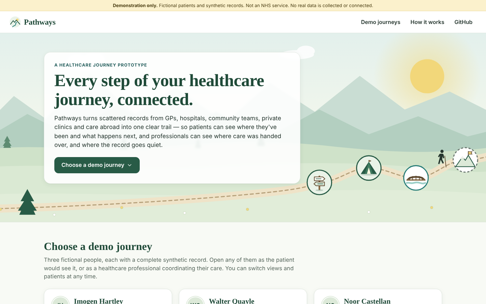
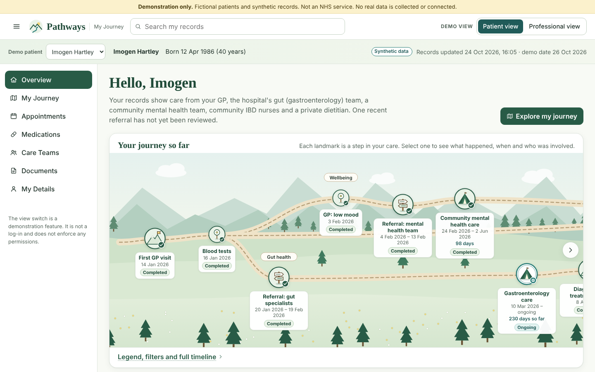
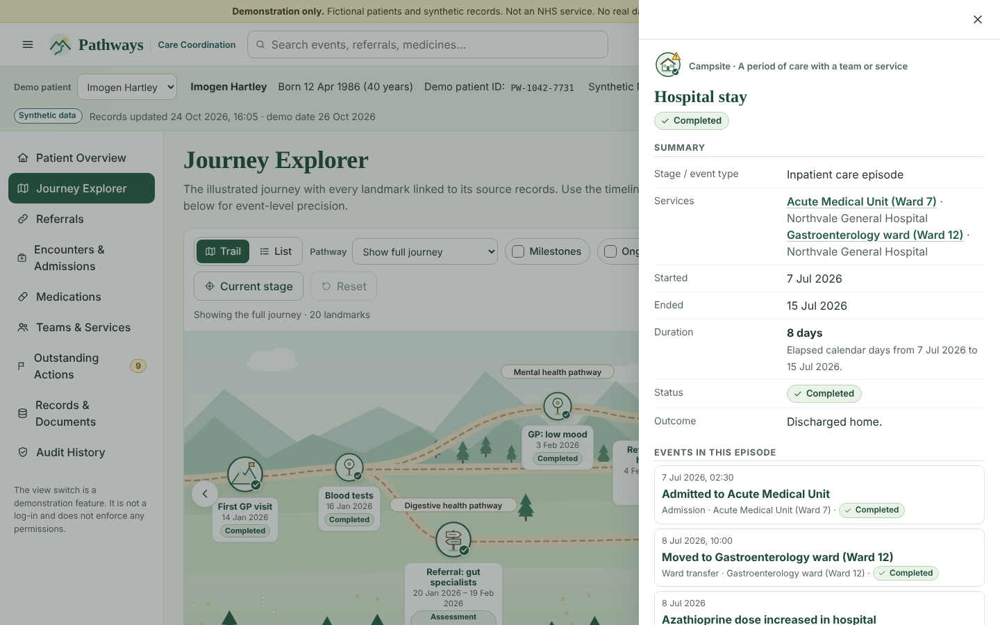
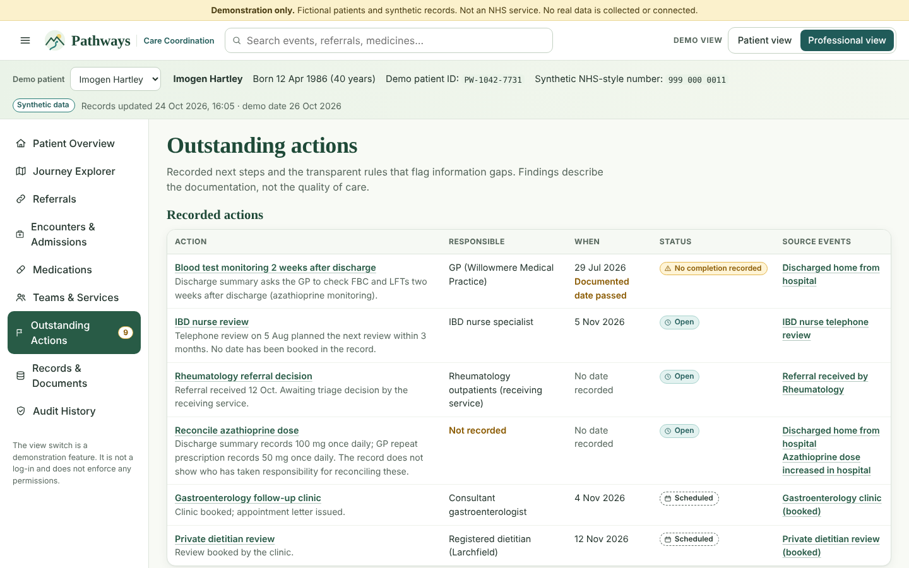
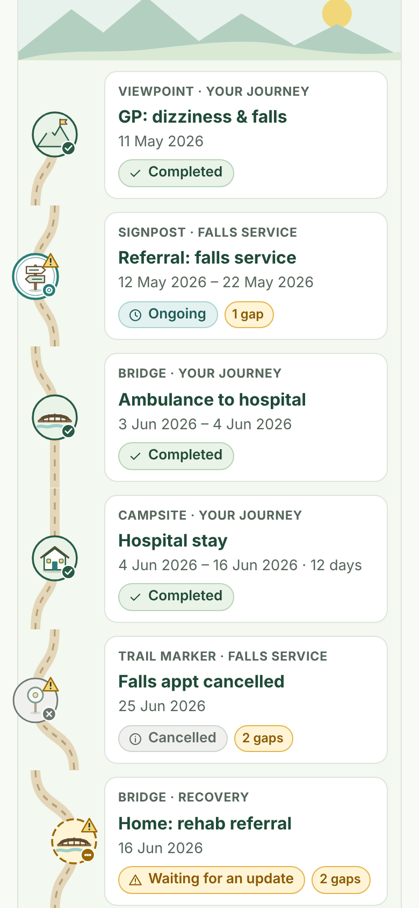

# Pathways

**Every step of your healthcare journey, connected.**

Pathways is an interactive service-design prototype. It turns fragmented healthcare records (GP, NHS hospital, community services, private providers and overseas care) into one connected journey, drawn as an illustrated hiking trail. Patients see a calm, plain-language view; professionals see the same data with provenance, referral tracking, medication reconciliation and transparent information-gap rules.

> **Demonstration only.** Every person, organisation, identifier, phone number and record is fictional. It is not an NHS service and is not connected to any clinical system. The Patient / Professional switch is a demo control. It is not authentication.

**Live demo:** https://pathways-demo-5ds.pages.dev — opens on a landing page where you choose a demo patient and a view (patient or professional).





| Journey Explorer (professional view) | Information gaps | Mobile trail |
|---|---|---|
|  |  |  |

## Run it

Requires Node 20+.

```bash
npm install
npm run dev        # http://localhost:5173  (esbuild watch + serve)
npm run build      # production build → dist/
npm run validate   # checks every relationship in the synthetic dataset and prints derived findings
npm run typecheck
```

## Deploy (Cloudflare Pages, free plan)

The build output is a static site in `dist/`. It uses hash routing, so no server rewrites are needed.

```bash
npx wrangler login
npm run deploy     # = build + wrangler pages deploy dist --project-name pathways-demo
```

You can also deploy without the CLI: Cloudflare dashboard → **Workers & Pages → Create → Pages → Upload assets**, then drag in the `dist` folder.

## What's inside

| Area | Where |
|---|---|
| Typed data model | `src/types.ts` |
| Synthetic patients (3) | `src/data/patient-*.ts`, shared organisations in `src/data/organisations.ts` |
| Data access | `src/lib/repo.ts` |
| Dates & durations | `src/lib/dates.ts` |
| Information-gap rules | `src/lib/gaps.ts` (12 deterministic rules) |
| Landmark view model & filters | `src/lib/landmarks.ts`, `src/lib/filters.ts` |
| Trail layout | `src/lib/layout.ts` |
| Landscape (desktop trail, mobile vertical trail, list) | `src/components/Landscape.tsx`, `Glyphs.tsx` |
| Detail panel (every record type) | `src/components/DetailPanel.tsx` |
| Timeline | `src/components/Timeline.tsx` |
| Pages | `src/pages/` |

More documentation:
- [docs/ARCHITECTURE.md](docs/ARCHITECTURE.md): architecture and data model
- [docs/UX-AND-DESIGN.md](docs/UX-AND-DESIGN.md): UX decisions and design system
- [docs/ROADMAP.md](docs/ROADMAP.md): what production would need
- [docs/TESTING.md](docs/TESTING.md): what was tested and how

## Demo patients

| Patient | Shows |
|---|---|
| **Imogen Hartley** (primary) | GP → gastroenterology referral with a 28-day wait for triage → assessment → diagnosis and treatment plan; a parallel community mental health episode (98 days); an overseas visit in Spain imported two months later; an emergency admission (8 days); discharge to community IBD nursing; private dietetics; a clinic with no recorded outcome; an azathioprine dose discrepancy; an unreviewed rheumatology referral. |
| **Walter Quayle** | Falls referral, hip fracture admission, a discharge referral that the receiving service never recorded, a cancelled appointment that was never rebooked, private physiotherapy. |
| **Noor Castellan** | A shorter, mostly well-coordinated asthma journey, an emergency visit in Lisbon, and a care period with an unknown start date (so the duration is shown as unknown). |

## Known limitations

- Fonts load from Google Fonts. Without network access, the app falls back to system fonts.
- The build uses esbuild directly rather than Vite. The source layout is Vite-compatible, and esbuild keeps the toolchain to one small dependency.
- The "current date" is fixed at **26 October 2026** (`DEMO_TODAY`) so that "upcoming", "ongoing" and waiting-time figures stay consistent.
